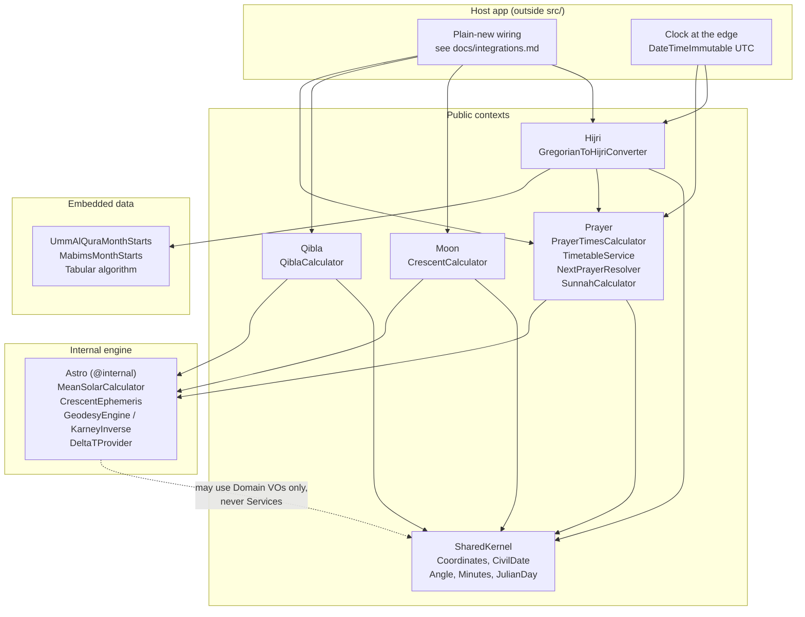

# Architecture

This document explains how `al-falaq/al-falaq` is structured, how data flows
through it, and where to extend it. For installation and usage, see
`README.md`; for per-feature guides, see `docs/`; for wiring snippets, see
`docs/integrations.md`.

## 1. System overview

**High-level purpose.** `al-falaq/al-falaq` is an offline Islamic-astronomy
library. Given a location and a date, it computes prayer times, Qibla
direction, Sunnah night markers, crescent-visibility verdicts, and
Gregorian↔Hijri conversions. All results are pure values; the library
performs no I/O, no network calls, and reads no clock.

**Architectural style.** Modular monolith library organised as bounded
contexts with a ports-and-adapters (hexagonal) layout:

- `SharedKernel`, `Prayer`, `Qibla`, `Moon`, `Hijri` are the public
  bounded contexts.
- Each context exposes **driving ports** (the API callers invoke) and
  **driven ports** (strategy interfaces callers select or implement).
- `Astro` is an `@internal` astronomy engine shared by the contexts. It is
  not part of the public API.

**Tech stack summary.** PHP `>= 8.2` (64-bit), zero runtime dependencies
(`require: php` only). SPL plus `DateTimeImmutable` for all time math.
Dev tooling: PHPUnit 11, PHPStan (max + strict rules), php-cs-fixer
(`@PER`), Rector, Infection. Coverage via pcov with a ratchet gate.

## 2. Architecture diagram



Dependency rule, enforced by `tests/ArchTest.php`:

```
Domain (Contracts, ValueObjects, Enums, Exceptions) has ZERO inward dependencies.
Application (Services) MAY depend on Domain + Astro-internal.
Astro-internal MAY depend on Domain value objects only, never on Application.
```

Concretely: `Astro/` must not reference `Prayer/`, `Qibla/`, `Moon/`, or
`Hijri/`; `Hijri/` must not reference `Astro/` or `Moon/`; domain
(`Contracts/`, `ValueObjects/`, `Enums/`) and `Moon/Strategies/` must not
import `Astro/`. Only `Services/` and non-Moon `Strategies/` may call the
engine.

## 3. Core components and modules

One class per file, PSR-4 under `AlFalaq\AlFalaq\`. Each context follows the
same role layout:

| Role | Convention | Responsibility |
|---|---|---|
| `Contracts/` | Interfaces only | Driving ports (`*Interface` suffix) and driven ports (short strategy names). Never business logic. |
| `Services/` | `final`, one command method, explicit ctor injection, `default()` factory | Orchestration only. No trigonometry here. |
| `Strategies/` | `final`, one `Contracts/` interface each | Swappable policy: one rule, one algorithm. |
| `ValueObjects/` | `final readonly`, validated ctor, UTC math only | Immutable inputs and outputs (`Coordinates`, `CivilDate`, `PrayerSchedule`, `HijriDate`, …). |
| `Enums/` | Backed enums | Closed option sets (`CalculationMethod`, `Madhab`, `Prayer`, …) plus method-default factories. |
| `Traits/` | Stateless, `private` helpers | Shared construction/lookup helpers. Never `Concerns/` or `Util/`. |
| `Exceptions/` | `*Exception` suffix, extend `AlFalaqException` | Typed failures. `*Error` names are forbidden. |

Context map:

- `src/SharedKernel/` — cross-context foundation. `ValueObjects/`
  (`Coordinates`, `CivilDate`, `Angle`, `Minutes`, `JulianDay`),
  `Exceptions/` (`AlFalaqException` base, `ValidationException`,
  `AstronomicalException`, `ConfigurationException`, …),
  `Contracts/` (`ClockView`, `DomainException`), `Traits/`
  (`HasWithersGuard`, `ValidatesFinite`).
- `src/Prayer/` — the largest context. `PrayerTimesCalculator` (single-day
  pipeline), `TimetableService` (monthly loop), `NextPrayerResolver`
  (today/tomorrow badge), `SunnahCalculator` (night fractions).
  Strategies cover Asr (closed `Madhab` shadow factor: 1.0 Shafi, 2.0 Hanafi),
  Isha (`AngleIsha`,
  `IntervalIsha`), Maghrib (`AngleMaghrib`, `MinutesAfterSunsetMaghrib`),
  high-latitude corrections (`MiddleOfNightCorrection`,
  `SeventhOfNightCorrection`, `TwilightAngleCorrection`), twilight
  (`SeasonAdjustedTwilight`), and polar-circle handlers (`NearestLatitude`,
  `NearestDay`, `Makkah`, `Throw`).
- `src/Qibla/` — `QiblaCalculator` plus two `GeodesyCalculator`
  strategies: `SphericalCalculator` (fast default) and
  `Wgs84KarneyCalculator` (precise opt-in). Qibla facts (Kaaba, self
  threshold) live on the seam interface; `Angle::normalized()` is the single
  unwind owner and `ClampsMakkahSelf` the single self-clamp.
- `src/Moon/` — `CrescentCalculator` plus four engine-free criterion
  strategies (`YallopEvaluator`, `OdehEvaluator`, `Mabims1992Evaluator`,
  `NeoMabims2021Evaluator`). Userland always goes through `Moon/`; never
  imports `Astro/` directly.
- `src/Hijri/` — `GregorianToHijriConverter` plus three `HijriCalendar`
  strategies (`TabularCalendar`, `UmmAlQuraCalendar`, `MabimsCalendar`) and
  the caller-supplied `OffsetStore` correction SPI.
- `src/Astro/` — `@internal` engine: `MeanSolarCalculator` (day-level solar
  geometry), `CrescentEphemeris` (sun/moon positions, sidereal time,
  moonset), `GeodesyEngine` / `KarneyInverse` (ellipsoidal geodesy),
  `DeltaTProvider`, plus engine-local `Contracts/` (`SolarModel`,
  `SolarDayEngine`) and `ValueObjects/` (`SolarPosition`, `SolarTime`).
  Shared Meeus theory lives once in `Traits/SharesSolarTheory`.

Supporting directories:

- `tests/` — mirrors `src/` per context, plus `Sweep/` (seeded property
  sweeps), `Wiring/` (smoke tests for every `docs/integrations.md`
  snippet), `Goldens/` (pinned-Python parity vectors, 25 CSVs +
  `Comparator.php` with minute equality), and `ArchTest.php` (layering and
  shape rules, `#[Group('arch')]`).
- `examples/` — runnable snippets plus `bench.php` (performance-tripwire
  harness: loose 50ms/30000ms gates, PRD 2ms/1000ms/16MB budgets as headroom).
- `tools/` — `export_goldens.py` (pin-parity prayer vectors from `PYTHON_PIN`,
  `--pin/--path/--out`), `gen_hijri.py` (month-start tables + goldens,
  `--path/--pin/--out`, writes in place), `gen_self_prayer_goldens.php`
  (drift-gated Tehran/Morocco/UOIF goldens, regenerate + diff-review in place),
  `gen_qibla_spherical.py` / `gen_qibla_wgs84.py` (CSV to stdout, diff against
  committed; diagnostics to stderr), `gen_moonsighting.py` (crescent
  characterization goldens, regenerate + diff-review),
  `coverage_gate.php` (coverage ratchet).
- `docs/` — per-context guides (`prayer.md`, `qibla.md`, `moon.md`,
  `hijri.md`, `sunnah.md`, `polar.md`), `integrations.md` (wiring recipes),
  `migration.md`.

## 4. Data flow

All computation is UTC in, UTC out. Time zones only appear at the display
edge via `forZone()`. The domain never reads the clock; callers pass
`$nowUtc` explicitly.

**Prayer, single day** (`PrayerTimesCalculator::calculate()`):

1. Normalise input (`Coordinates` value object or `[lat, lon]` pair) and
   validate parameters (e.g. `isRamadan` requires Umm al-Qura).
2. Check whether the sun is defined for the date/place via the engine
   (`MeanSolarCalculator::isSolarDefined`). If not, dispatch to the
   configured `PolarCircleHandler` (nearest latitude / nearest day /
   Makkah coordinates / throw) and re-probe.
3. Fetch the solar day (`solarTime`: transit, sunrise, sunset) and the next
   sunrise to derive night length.
4. Resolve high-latitude portions via `HighLatitudeCorrection`, or apply
   the Moon-Sighting-Committee seasonal branch (`TwilightModel`) when that
   method or rule is active.
5. Compute each marker (fajr hour-angle → sunrise → dhuhr transit → Asr
   shadow → maghrib angle/interval → isha angle/interval), combine
   method-plus-caller offsets (`PrayerAdjustments::combinedWith`), then
   apply a single half-up rounding (`Minutes::roundedHalfUp`) per marker.
6. Return an immutable `PrayerSchedule` (ten UTC instants). `syuruk` is a
   sunrise alias; `imsak` derives from final fajr; ishraq/dhuha derive from
   adjusted sunrise.

**Timetable** (`TimetableService::monthly()`): thin loop that builds a
method-aware calculator via `defaultFor($parameters)` and calls the
single-day pipeline once per calendar day. No yearly helper by design;
callers loop months.

**Next prayer** (`NextPrayerResolver::resolve()`): pure function of
`($today, $tomorrow, $nowUtc)`. Scans both schedules in canonical key
order and returns the first instant after `$nowUtc`. `$nowUtc` must already
be UTC; the resolver validates this.

**Sunnah markers** (`SunnahCalculator`): night runs
`today.maghrib → tomorrow.fajr`. Middle, first-third, and second-third are
fractions of that UTC interval, rounded once. DST-safe because all math is
UTC.

**Qibla** (`QiblaCalculator::calculate()`): normalise observer coordinates,
call `GeodesyCalculator::inverse($observer)` (spherical Todhunter/haversine
or WGS84/Karney), wrap the bearing/distance in an immutable `QiblaResult`.

**Crescent** (`CrescentCalculator`): two phases.

1. `atSunset($coordinates, $date)` runs the Meeus pipeline on the engine:
   fractional-hour sunset, Julian Day anchored on the UTC sunset instant
   (TT for the ephemeris, UT for sidereal time), parallax-corrected
   topocentric moon against geocentric sun, elongation (ARCL), moon age via
   30-day hourly ARCL-minimum search, analytic moonset and lag. Returns an
   immutable `CrescentGeometry`.
2. `evaluate()` / `evaluateGeometry()` fans that single geometry bundle out
   to the four criterion strategies and returns verdicts keyed by
   criterion. Strategies are pure polynomials over the geometry; only the
   service touches the engine.

**Hijri conversion** (`GregorianToHijriConverter::convert()`):

1. Resolve the civil date. Default frame: the caller's own zone decides the
   date. With `changeAtSunset: true`, use the UTC date and roll it at the
   observer's maghrib (probed through `PrayerTimesCalculator`, never
   reimplemented).
2. Convert the civil date via the selected `HijriCalendar` (tabular
   arithmetic or month-start table lookup).
3. Optionally apply an `OffsetStore` day correction via `shift()`. The
   calendar itself is date-only and never sees a time zone.

## 5. Design patterns and principles

- **Ports and adapters.** Service contracts (`PrayerTimesCalculatorInterface`,
  `TimetableServiceInterface`, `NextPrayerResolverInterface`) are driving
  ports, each implemented once in `Services/`. Strategy contracts
  (`IshaRule`, `MaghribRule`, `HighLatitudeCorrection`,
  `PolarCircleHandler`, `TwilightModel`, `GeodesyCalculator`,
  `HijriCalendar`, `OffsetStore`, `CrescentEvaluator`) are driven ports with
  one or more `Strategies/` implementations or caller-supplied doubles.
- **Strategy over branching.** Method differences (madhhab, angles vs.
  intervals, night rules, polar fallbacks, geodesic models, calendar
  systems, visibility criteria) are separate strategy classes, not flags in
  a god class. `CalculationMethod::defaultParameters()` freezes the
  19-method preset table; `defaultFor()` maps parameters to strategies.
- **Explicit construction, no container.** Services take strategies by
  constructor injection and expose `default()` / `defaultFor()` named
  factories for the common wirings. There are no service providers,
  bundles, or config files. `docs/integrations.md` shows plain-`new`
  construction for every feature.
- **Immutable value objects.** Inputs and outputs are `final readonly`
  (`Coordinates` validates ranges and finiteness at construction;
  `CivilDate` owns calendar arithmetic; `Minutes` owns offset addition and
  rounding). Outputs are new instances, never mutated state.
- **UTC math, display at the edge.** All domain math is UTC on
  `DateTimeImmutable`. Zones appear only through `forZone()` /
  `toArray()` when rendering. Mutable `DateTime` and `DateTimeInterface`
  unions are banned by `ArchTest`.
- **Explicit clock.** The domain never calls "now". Host apps read their
  clock (optionally via the suggested `psr/clock` adapter) and pass the
  instant in. This keeps every calculation deterministic and testable.
- **Offline and dependency-free.** No I/O, no network, no framework types
  in `src/` (`curl_`, `exec`, `http` URLs are banned by `ArchTest`; the
  runtime `composer.json` must stay `php`-only). The library is stateless:
  same inputs always produce the same outputs.
- **Fail fast with typed exceptions.** `ValidationException` for bad
  caller input, `ConfigurationException` for inconsistent wiring (e.g.
  `isRamadan` without Umm al-Qura, `changeAtSunset` without coordinates),
  `AstronomicalException` (incl. `UndefinedScheduleException`) when the sky
  itself is undefined (polar day/night). All extend `AlFalaqException`.
- **Parity by golden vectors.** Every numeric behaviour is pinned against
  the Python implementation (`PYTHON_PIN`, see `CONTRIBUTING.md`) in
  `tests/Goldens/`. Each vector cites its source (Meeus page/edition or
  Takwim URL + date). Intentional divergence updates docs and goldens
  together; code wins, docs follow.
- **Machine-checked shape.** `ArchTest` enforces `final` services and
  value objects, `*Exception` naming, no `Util/` namespace, mandatory
  docblocks (`@param $name` / `@return` on all public API), and the
  layering rules above. `composer arch` runs these in isolation.

Key trade-off: the `Astro/` engine is deliberately duplicated in structure
from the pinned Python rather than replaced with a generic astronomy
package, because behavioural parity (down to whole-second seasonal caps and
signed-latitude gates) matters more than reuse. The cost is contained by
keeping all trig behind the engine boundary so `Services/` stay readable.

## 6. Data storage and persistence

There is no database, cache, or file storage. "Persistence" in this library
means versioned astronomical tables shipped as code:

- `Hijri/Data/UmmAlQuraMonthStarts.php` (years 1423–1500) and
  `Hijri/Data/MabimsMonthStarts.php` (years 1445–1500) are generated lookup
  tables. Provenance, digests, and regeneration steps live in
  `UQ_PROVENANCE.md` and `tools/gen_hijri.py`.
- `TabularCalendar` is pure arithmetic (no table). `MabimsCalendar` adds
  per-country (`MabimsCountry`) rules on top of shared month starts.
- Official day corrections are not stored; callers supply them through the
  `OffsetStore` SPI, applied as `calendar->shift($hijri, $offset)`.

There are no migrations. Table changes are code changes: regenerate via the
tool, update provenance, and pin new golden vectors.

## 7. Security, authentication and authorization

Not applicable in the usual sense: this is a stateless compute library
with no users, sessions, credentials, or network surface.

The relevant hardening is input validation and a minimal attack surface:

- Every public entry point validates at the boundary. `Coordinates`
  rejects non-finite and out-of-range values; `CivilDate` rejects
  impossible dates; resolvers reject non-UTC or missing context with typed
  exceptions rather than silent clamping.
- No secrets, no tokens, no serialised payloads to sign or encrypt.
  Magnetic declination for Qibla is caller-supplied, never fetched.
- Offline-by-construction (`ArchTest::testOfflineOnly`) means there is no
  SSRF, DNS, or update-channel risk from the library itself.

Host apps remain responsible for their own auth, rate limiting, and output
escaping; `DisplaySchedule::toArray()` returns plain ISO-8601 strings with
no HTML.

## 8. Integration seams and extension points

**Call these (driving ports — stable entry points):**

- Prayer: `PrayerTimesCalculatorInterface` (`PrayerTimesCalculator`),
  `TimetableServiceInterface` (`TimetableService`),
  `NextPrayerResolverInterface` (`NextPrayerResolver`), plus concrete
  `SunnahCalculator` and `QiblaCalculator`.
- Moon: `CrescentCalculator` (`atSunset()` for geometry,
  `evaluate()` / `evaluateGeometry()` for verdicts).
- Hijri: `GregorianToHijriConverter::convert()` with a `HijriCalendar`.

**Implement or select these (driven ports — extension points):**

- Prayer behaviour: `IshaRule`, `MaghribRule`,
  `HighLatitudeCorrection`, `PolarCircleHandler`, `TwilightModel`.
- Qibla precision: `GeodesyCalculator` (`default()` = spherical,
  `wgs84()` = Karney).
- Moon criteria: `CrescentEvaluator` (four shipped; inject doubles in
  tests via the same contract).
- Hijri data: `HijriCalendar` (tabular / Umm al-Qura / MABIMS) and
  `OffsetStore` (caller-owned corrections).

**Payload contracts (versioned — do not change without a minor bump):**

- `PrayerSchedule::all()` keys, in order: `imsak, fajr, sunrise, syuruk,
  ishraq, dhuha, dhuhr, asr, maghrib, isha` — UTC `DateTimeImmutable`.
  `toArray()` maps the same keys to `Y-m-d\TH:i:s+00:00`;
  `DisplaySchedule::toArray()` renders the same keys in the display zone.
- `QiblaResult`: bearing in `[0, 360)` plus distance in km.
- `CrescentGeometry` / `CrescentVerdict`: altitudes, elongation, ages,
  lag, azimuth delta, illumination, width; verdicts keyed `yallop, odeh,
  mabims1992, neomabims2021`.
- `HijriDate`: year/month/day plus calendar identity; month labels are
  `en`/`ar` only via `HijriMonth::label()` (no ICU).

**What NOT to do:**

- Do not import `Astro/` from userland — go through `Moon/` or the
  relevant service. `ArchTest` fails engine imports outside
  `Services/` and non-Moon `Strategies/`.
- Do not read the clock inside the domain — pass `$nowUtc` from the edge.
- Do not add framework types, containers, or I/O to `src/`; wiring recipes
  belong in `docs/integrations.md` as plain-`new` snippets (and must be
  covered by `tests/Wiring/`).
- Do not add a `Util/` namespace, `*Error` classes, mutable `DateTime`, or
  an `Interface` suffix outside service contracts (the suffix avoids a PHP
  same-short-name import collision — see `AGENTS.md` gotchas).
- Do not add output keys or reorder `all()` without a minor version bump.

## 9. Deployment and infrastructure

There is none beyond packaging: this is a `type: library` Composer package
with no build step, no daemon, no CLI, and no assets.

What affects code design:

- `composer.json` runtime stays `php`-only; CI asserts zero locked runtime
  packages. The `config.platform.php = 8.2.0` pin keeps the lock
  installable on 8.2/8.3/8.4 — never resolve the lock on a newer PHP
  without it.
- CI (`.github/workflows/test.yml`, Ubuntu-only) runs lint/cs/stan once on
  PHP 8.4, then tests plus `bench --budget` on 8.2/8.3/8.4 × UTC plus one
  `America/New_York` leg on 8.4. A manual Windows gate runs on `v*` tags.
- Quality gates before merge: `composer ci` (lint + cs + stan + test),
  `composer arch`, coverage ratchet (`tools/coverage_gate.php`, floor only
  moves up, currently 95), and the bench budget. Mutation testing
  (`composer mutation`, MSI ≥ 85 configured in `infection.json.dist`)
  runs in CI.
